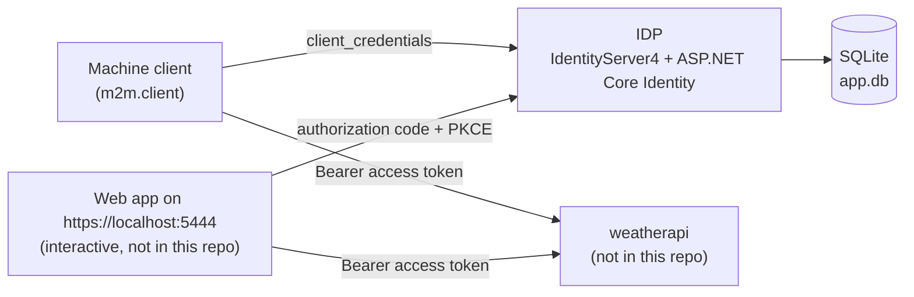

# IdentityServer4Pro

An OpenID Connect / OAuth 2.0 identity provider (IDP) built with IdentityServer4 on ASP.NET Core 7. Clients, resources, scopes and test users are all configured in memory. ASP.NET Core Identity with SQLite is wired up next to it.

> **Note:** IdentityServer4 reached end of life in December 2022 and gets no more security fixes. Its successor is [Duende IdentityServer](https://duendesoftware.com/products/identityserver), which uses a commercial license. Version 4.1.2, used here, has known advisories (`GHSA-55p7-v223-x366`, `GHSA-ff4q-64jc-gx98`). Use this project for learning only.

## Features

- IdentityServer4 with in-memory configuration (`IDP/Config.cs`):
  - **Identity resources:** `openid`, `profile` (name, email, website, given_name, family_name, address), `role`
  - **API scopes:** `weatherapi.read`, `weatherapi.write` (the write scope includes the `role` claim)
  - **API resource:** `weatherapi`, which groups both scopes, emits the `role` claim and has its own API secret for token introspection
  - **Clients:**

    | Client ID | Grant type | Allowed scopes | Notes |
    | --- | --- | --- | --- |
    | `m2m.client` | Client credentials | `weatherapi.read`, `weatherapi.write` | Machine-to-machine client |
    | `interactive` | Authorization code + PKCE | `openid`, `profile`, `weatherapi.read` | Redirects to `https://localhost:5444/signin-oidc`, consent required, refresh tokens allowed |

  - **Test users:** `assaf`, `alice` (role `admin`) and `bob` (role `user`), each with a matching password
- Developer signing credential: an RSA key is generated on first run and saved to `IDP/tempkey.jwk`
- ASP.NET Core Identity (default UI) with an Entity Framework Core SQLite store (`IDP/app.db`) and the initial Identity migration
- MVC home and privacy pages styled with Bootstrap

## Tech stack

| Component | Version |
| --- | --- |
| Target framework | .NET 7 (`net7.0`) |
| IdentityServer4 | 4.1.2 |
| Microsoft.AspNetCore.Identity.EntityFrameworkCore / Identity.UI | 7.0.9 |
| Microsoft.EntityFrameworkCore.Sqlite / Tools | 7.0.9 |
| Microsoft.AspNetCore.Diagnostics.EntityFrameworkCore | 7.0.9 |
| Serilog / Serilog.AspNetCore / Serilog.Sinks.Console | 3.1.1 / 8.0.0 / 5.0.0 (referenced, not configured in `Program.cs`) |

## Architecture



Only the IDP is in this repository. The `weatherapi` resource and the client on port 5444 are referenced in the configuration but are not included here.

## Endpoints

IdentityServer4 protocol endpoints:

| Method | Route | Purpose |
| --- | --- | --- |
| GET | `/.well-known/openid-configuration` | Discovery document |
| GET | `/.well-known/openid-configuration/jwks` | Public signing keys |
| GET | `/connect/authorize` | Authorization endpoint |
| POST | `/connect/token` | Token endpoint |
| GET/POST | `/connect/userinfo` | UserInfo endpoint |
| POST | `/connect/introspect` | Token introspection |
| POST | `/connect/revocation` | Token revocation |
| GET | `/connect/endsession` | End session (logout) |

Application pages:

| Route | Description |
| --- | --- |
| `/`, `/Home/Privacy` | MVC home and privacy pages |
| `/Identity/Account/Register`, `/Identity/Account/Login` | ASP.NET Core Identity default UI |

## Prerequisites

- A .NET SDK that can target `net7.0`. The project builds with the .NET 7, 8 and 10 SDKs. Newer SDKs show warning `NETSDK1138` because .NET 7 is out of support.
- To run the app, an ASP.NET Core 7 runtime, or roll-forward to a newer one (see below).
- Optional: `dotnet-ef` to apply migrations (`dotnet tool install --global dotnet-ef`)

## Configuration

`IDP/appsettings.json`:

| Key | Default | Description |
| --- | --- | --- |
| `ConnectionStrings:DefaultConnection` | `DataSource=app.db;Cache=Shared` | SQLite database for ASP.NET Core Identity |

Clients, scopes, resources and test users live in `IDP/Config.cs`, not in configuration files. The client secrets (`secret`) and test user passwords are demo values only.

Launch profiles (`IDP/Properties/launchSettings.json`):

| Profile | URLs |
| --- | --- |
| `https` | `https://localhost:7093`, `http://localhost:5064` |
| `http` | `http://localhost:5064` |

## Getting started

```bash
git clone https://github.com/Ahmed-Manai/IdentityServer4Pro.git
cd IdentityServer4Pro
dotnet restore
dotnet build
dotnet ef database update --project IDP
dotnet run --project IDP --launch-profile https
```

If only a newer ASP.NET Core runtime is installed, set `DOTNET_ROLL_FORWARD=Major` before `dotnet run`.

The SQLite database (`IDP/app.db`) and the developer signing key (`IDP/tempkey.jwk`) are not committed. `dotnet ef database update` creates the Identity database, and the signing key is generated on first run. To recreate the database later, delete `IDP/app.db` and run:

```bash
dotnet ef database update --project IDP
```

### Request a token (client credentials)

```bash
curl -k -X POST https://localhost:7093/connect/token \
  -d grant_type=client_credentials \
  -d client_id=m2m.client \
  -d client_secret=secret \
  -d scope=weatherapi.read
```

Check the discovery document at `https://localhost:7093/.well-known/openid-configuration`.

## Known limitations

- The IdentityServer4 Quickstart UI (login, consent and logout pages under `/Account/*` and `/Consent`) is not included. The ASP.NET Core Identity UI is served under `/Identity/Account/*` and is not linked to IdentityServer, because `AddAspNetIdentity` is not used. So the `interactive` client's authorization code flow cannot complete as is. The client credentials flow works.
- The in-memory test users and the ASP.NET Core Identity users in SQLite are two separate user stores.

## Tests

The repository has no test projects yet.
